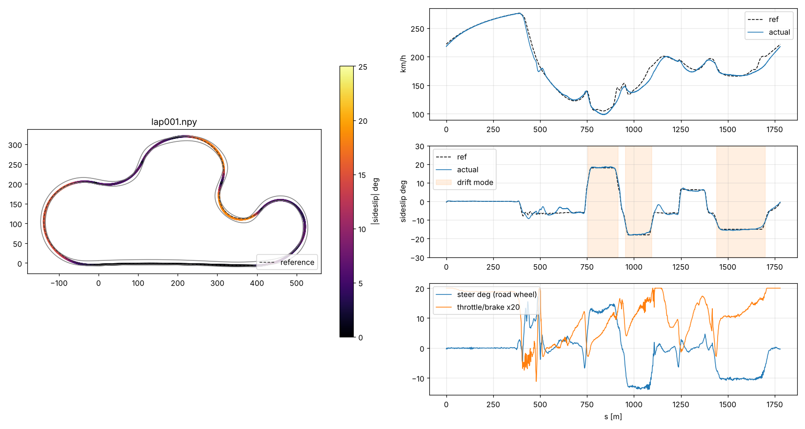

# acopt — optimal control for Assetto Corsa

A framework that (1) computes the minimum-lap-time line **and** control inputs for a
car/track under the car's real constraints, (2) drives it in real time with a
nonlinear MPC, (3) can follow drift profiles (target sideslip per corner) that you
change **while the car is driving**, and (4) improves the plan lap after lap.

Everything runs against a built-in simulator first, so you can develop and tune
without the game, then switch one line in the config to drive Assetto Corsa.

```
          ┌──────────── offline / between laps ────────────┐
 track ──►│ planner.py   min-lap-time OCP (CasADi + IPOPT)  │──► race line + controls
 car   ──►│ drift.py     steady-state drift equilibria      │──► V, δ, T for any β, R
          └─────────────────────────────────────────────────┘
                         │                     ▲  grip map μ(s)
                         ▼                     │
   profile YAML ──► profile.py  references vs s (race / drift segments, blending)
   live UDP cmds ─►      │ (rebuilt in a worker thread, swapped atomically)
                         ▼
 AC shared mem ─► controller.py  Frenet state, actuator observer, latency comp.,
 (or sim.py)      ├─ mpc.py      spatial NMPC, 20 Hz, all refs/weights = parameters
                  ├─ online grip estimate μ̂ (scales model grip + speed refs)
                  └─ supervisor  MPC → MPC_SAFE → FALLBACK → SAFE_STOP → RECOVER
                         │
                         ▼
               vJoy (steer, gas, brake)  ─►  Assetto Corsa
                         │
                 lap logs ─► learning.py (grip map) ─► re-plan ─┘
                         └─► sysid.py (fit car parameters)
```

## What was verified (simulator, this repo)

The sim's "real" car deliberately differs from the controller's model (−6 % tyre
grip, −8 % downforce, −3 % power, a −8 % grip patch in one sector, 20 ms delay,
30/50 ms steering/pedal lag, sensor noise):

| Test | Result |
|---|---|
| Min-lap-time plan, 1.78 km test circuit, 445 stations | converges, ~35–40 s solve (warm re-plans similar) |
| MPC solve time (N=20, 2 SQP iterations) | ~20 ms median, ~27 ms p95 |
| Learning from a pessimistic start (μ₀ = 0.85), 7 laps | 35.98 → 34.62 s, monotonic, 0 incidents |
| Drift profile: right→left transition at 18°, 15° sweeper at ~170 km/h | sideslip error 0.45° RMS, 1.6° max |
| Live change of drift angle 12° → 18° over UDP mid-session | applied in the next lap, tracked at 1.6° RMS |



Nothing has been run against Assetto Corsa itself — see **Verify on your install**.

## Quick start (simulator)

```bash
pip install -r requirements.txt
python scripts/run.py configs/sim_test.yaml --laps 6               # race line + learning
python scripts/run.py configs/sim_test.yaml --laps 2 --no-learn --profile profiles/drift_demo.yaml
python scripts/plot_lap.py configs/sim_test.yaml out/logs_sim/lap001.npy
```
The first run plans the line (~40 s) and caches it in `out/`.

## Assetto Corsa: Vallelunga Club + F2004

1. **Install** Python 3.10+ on Windows, `pip install -r requirements.txt`, and
   [vJoy](https://sourceforge.net/projects/vjoystick/) with one device (axes X/Y/Z, 8 buttons).
2. **AC controls**: steering = vJoy X, throttle = Y, brake = Z, gear up/down = buttons 1/2.
   Steering gamma 1.0, filter 0, speed sensitivity 0, no deadzones. Controller
   steering lock = the car's full lock. Auto-clutch on; auto-shifter on to start.
   TC off for drifting (the model assumes no assists).
3. **Track path**: edit `configs/vallelunga_club_f2004.yaml` → `track.path` to your
   `content/tracks/vallelunga/<layout>/ai/fast_lane.ai`. Check the layout folder name.
4. **Calibrate frames**: start a practice session, then
   `python scripts/ac_probe.py configs/vallelunga_club_f2004.yaml` and drive ~30 s yourself
   (straights + left and right corners). It writes `configs/ac_calibration.yaml` and tells
   you the `sign_z` to put in the track config.
5. **Plan**: `python scripts/plan_line.py configs/vallelunga_club_f2004.yaml` → line + plot.
6. **Drive**: `python scripts/run.py configs/vallelunga_club_f2004.yaml --laps 10`.
   Start with `speed_scale: 0.9` in `profiles/race.yaml`; learning raises grip where it can.
7. **Identify the car** after a few laps:
   `python scripts/identify.py configs/vallelunga_club_f2004.yaml out/logs_ac/lap00*.npy --save configs/f2004_id.yaml`,
   point `vehicle:` at the result, delete the cached line, re-plan.

Kunos cars ship encrypted data (`data.acd`), so `configs/f2004.yaml` holds informed
estimates (mass, power, aero, tyres, steering lock). Steps 4–7 replace guesses with
measurements. The values marked `(!)` matter most.

## Drift profiles and live changes

A profile is the race line plus segments. A drift segment holds a sideslip angle
through a range of `s`:

```yaml
segments:
  - {name: T2, mode: drift, s_start: 740, s_end: 930, beta_deg: 18, line: race, blend_m: 30}
```

`scripts/corners.py <config>` lists every corner's `s` range, direction, radius and
the **largest drift angle the car can hold there**. With the F2004's ~17° road-wheel
lock that is about 20–24°: beyond it there is no counter-steer left, so requested
angles are automatically reduced where needed and reported as warnings rather than
spinning the car.

Change things while it drives — any of these take effect within one profile rebuild
(≈0.3–2 s, in a background thread; the controller never stalls):

```bash
python scripts/tune.py drift T3 --beta 22 --start 940 --end 1110   # add/modify a segment
python scripts/tune.py race T3                                      # back to race mode
python scripts/tune.py weights drift beta=2 n=1                     # MPC weights
python scripts/tune.py speed 0.95                                   # global speed scale
python scripts/tune.py load profiles/drift_demo.yaml
python scripts/tune.py status | pause | resume | stop
```
Or edit and save the profile YAML: it is watched and reloaded automatically.

## How each part works

**Vehicle model** (`vehicle.py`): dynamic bicycle, Pacejka lateral curves per axle,
friction-ellipse combined slip (so throttle-on oversteer — i.e. drift — is in the model),
downforce/drag, longitudinal load transfer, tyre load sensitivity, power- and
traction-limited drive, brake bias. Steering and pedal are states driven by rate
inputs, so actuator rate limits are hard constraints. One CasADi definition serves
the planner, MPC, drift solver, simulator and system identification.

**Planner** (`planner.py`): direct multiple shooting in the spatial domain, lap time
as objective, periodic boundary conditions, track limits with a margin, tyre slip
and sideslip limits that keep the race line on the stable side of the tyre curve.
It takes a per-metre grip map, which is how learning reshapes the line.

**MPC** (`mpc.py`): spatial-domain NMPC, 20 stations over ~1.2 s. Curvature, track
limits, every reference, grip, the race/drift blend **and all weights** are solver
parameters, so nothing recompiles when you change them. Track limits are soft
(slack) so the problem stays feasible after a moment. Primary solver: 2-iteration
SQP (real-time-iteration style); on a bad iterate it retries with a time-capped IPOPT.
A plan is accepted by checking its dynamics defects, not the solver's status string.

**Controller** (`controller.py`): Frenet projection, an actuator observer (the model's
δ and T are the *actual* wheel angle/pedal, not the last command), latency compensation
by forward prediction, and lag inversion by leading the plan by the lag constant.
An online grip estimate compares measured and predicted lateral acceleration when the
tyres are loaded and scales both the model grip and the speed references at once.

**Supervisor**: excursions (off line, slip beyond reference + margin, plan needing
slack) → `MPC_SAFE` (same MPC with a 15 % grip haircut); solver down and last plan
expired → geometric fallback; spin or stale telemetry → `SAFE_STOP`; then `RECOVER`
creeps back to the line. The fallback never brakes hard mid-slide.

**Learning** (`learning.py`): per 5 m bin, compares measured acceleration with the
model's prediction at the same state. At-limit bins move toward the grip actually
delivered; incidents cut grip over the approach; clean sub-limit bins creep up.
Then the planner re-solves warm-started. Stops when lap time stops improving.

## Verify on your install

These are written from the AC SDK layouts and community documentation but could not
be tested against the game here:

- `ac/shared_memory.py` struct layouts (physics/graphics pages). The probe prints
  live values; sanity-check speed, gear and coordinates.
- `Track.from_fast_lane_ai` parsing of the AI spline's width block. If widths look
  wrong the probe's "inside the corridor" figure will be low; set `half_width`.
- `steerAngle` normalisation and the vJoy axis direction (`steer_sign`).
- Actuator lag and latency (`tau_delta`, `tau_T`, `latency_s`): measure from a
  logged steering step, or start with the defaults and reduce `latency_s` if the
  car weaves.

## Tuning notes

- Weaving on straights → raise `ddelta` weight or `latency_s`; check `tau_delta`.
- Running wide at corner exit → lower `speed_scale` first, then let learning work.
- Drift angle undershoots → raise drift `beta`/`r` weights; check the
  equilibrium is feasible with `corners.py`.
- Need more speed: the MPC is plain CasADi. For 100 Hz+ export the same model to
  acados (SQP-RTI, HPIPM); the parameter layout in `mpc.py` maps one-to-one.
- System identification fits *effective* parameters: grip and downforce trade off
  against each other, so judge it by prediction error, not by individual values.

## Layout

```
acopt/            vehicle, track, planner, drift, profile, mpc, controller,
                  learning, sysid, live, session, sim, env, ac/(shared_memory, ac_env)
configs/          f2004.yaml, vallelunga_club_f2004.yaml, sim_test.yaml, ac_calibration.yaml
profiles/         race.yaml, drift_demo.yaml
scripts/          run, plan_line, tune, corners, identify, ac_probe, plot_lap
```
