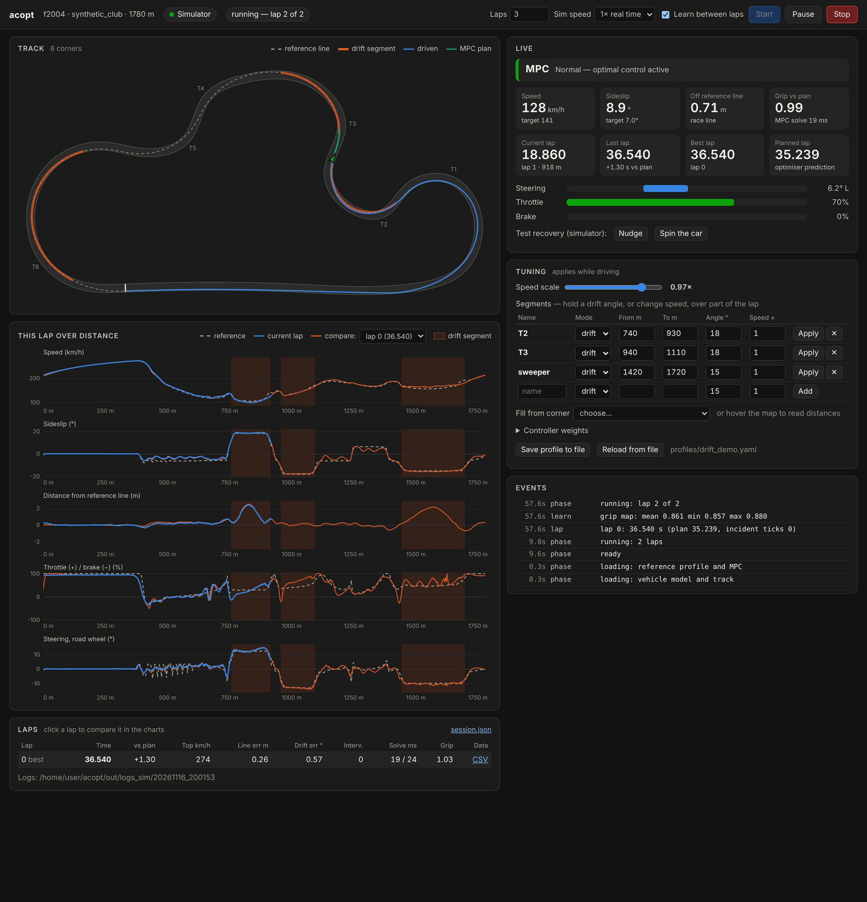
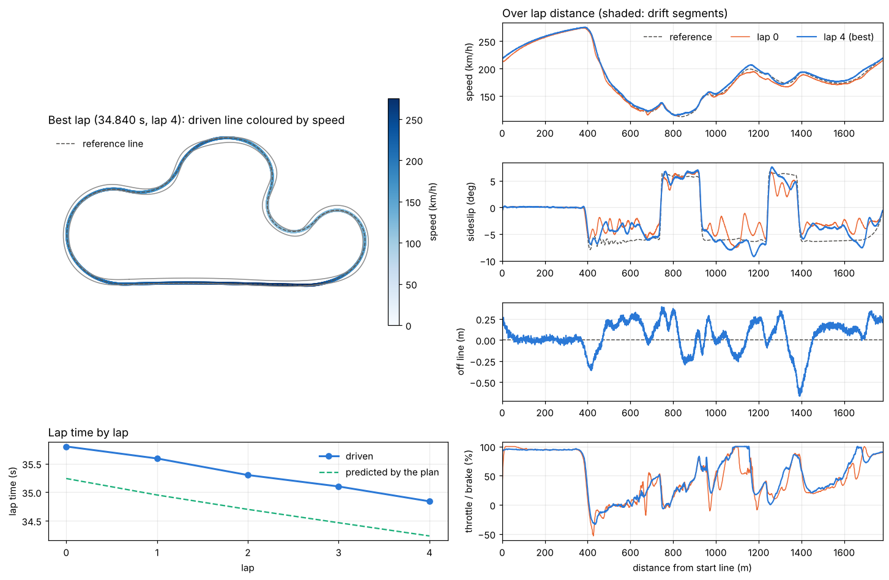

# acopt — optimal control for Assetto Corsa

A framework that (1) computes the minimum-lap-time line **and** control inputs for a
car/track under the car's real constraints, (2) drives it in real time with a
nonlinear MPC, (3) can follow drift profiles (target sideslip per corner) that you
change **while the car is driving**, and (4) improves the plan lap after lap.

Everything runs against a built-in simulator first, so you can develop and tune
without the game, then point it at an Assetto Corsa config. A web dashboard shows
what the car is doing, lets you tune it while it drives, and every lap is saved as CSV.

```
          ┌──────────── offline / between laps ────────────┐
 track ──►│ planner.py   min-lap-time OCP (CasADi + IPOPT)  │──► race line + controls
 car   ──►│ drift.py     steady-state drift equilibria      │──► V, δ, T for any β, R
          └─────────────────────────────────────────────────┘
                         │                     ▲  grip map μ(s)
                         ▼                     │
   profile YAML ──► profile.py  references vs s (race / drift segments, blending)
   live UDP cmds ─►      │ (rebuilt in a worker thread, swapped atomically)
                         ▼
 AC shared mem ─► controller.py  Frenet state, actuator observer, latency comp.,
 (or sim.py)      ├─ mpc.py      spatial NMPC, 20 Hz, all refs/weights = parameters
                  ├─ online grip estimate μ̂ (scales model grip + speed refs)
                  └─ supervisor  MPC → MPC_SAFE → FALLBACK → SAFE_STOP → RECOVER
                         │
                         ▼
               vJoy (steer, gas, brake)  ─►  Assetto Corsa
                         │
                 lap logs ─► learning.py (grip map) ─► re-plan ─┘
                         └─► sysid.py (fit car parameters)
```

## Quick start (no game needed)

```bash
pip install -r requirements.txt
python scripts/ui.py
```

This opens the dashboard at `http://127.0.0.1:8765` against the built-in simulator.
The first start plans the race line (about a minute, cached in `out/` afterwards).
Press **Start**.



What the dashboard does:

- **Track map** with the reference line, drift segments, the driven line, the MPC's
  current plan and the car (coloured by supervisor state). Hover to read distances.
- **Live panel**: supervisor state in words, speed / sideslip / line error against
  their targets, grip estimate, solve time, lap times, steering and pedal bars.
- **This lap over distance**: speed, sideslip, line error, pedals and steering
  against the reference, with any finished lap overlaid for comparison.
- **Tuning while driving**: speed scale, drift/race segments (fill them from the
  detected corner list), controller weights, save/reload the profile YAML. Invalid
  input is refused with a message and nothing is applied.
- **Laps table** with per-lap metrics and CSV download, lap-time trend, `session.json`.
- **Events**: every supervisor transition (with the reason and where it happened),
  live commands, warnings, learning updates.
- Simulator only: sim speed (0.5× to max) and **Nudge / Spin the car** buttons to
  watch the recovery logic work.

Headless alternative: `python scripts/run.py configs/sim_test.yaml --laps 6`.

## Getting data out

Every session writes to a timestamped folder under the config's `log_dir`
(e.g. `out/logs_sim/20260101_120000/`; `latest.txt` points at the newest):

| File | Content |
|---|---|
| `lapNNN.csv` | one row per control tick (100 Hz): time, position, speeds, sideslip, references, commands, grip estimate, supervisor state, solve time. SI units, radians. Opens in Excel / pandas. |
| `session.json` | one record per lap (lap time, planned time, top speed, RMS line error, drift-angle error, interventions, solve-time percentiles, time share per supervisor state) plus the profile used. |
| `partial.csv` | the unfinished lap when a run is stopped or aborts, for diagnosis. |
| `report.png`, `report.txt` | made by `python scripts/report.py [config] [session_dir]`. |

`scripts/report.py` output for a 5-lap learning session in the simulator:



## What was verified (simulator, this repo)

The sim's "real" car deliberately differs from the controller's model (−6 % tyre
grip, −8 % downforce, −3 % power, a −8 % grip patch in one sector, 20 ms delay,
30/50 ms steering/pedal lag, sensor noise):

| Test | Result |
|---|---|
| Min-lap-time plan, 1.78 km test circuit, 445 stations | converges, ~35–45 s solve |
| MPC solve time (N=20, 2 SQP iterations) | ~20 ms median, ~24 ms p95 |
| Learning from a pessimistic start (μ₀ = 0.85), 5 laps | 35.80 → 34.84 s, every lap faster, 0 interventions |
| Drift profile (18° / 18° / 15° segments) | sideslip error ~0.6° RMS inside drift segments |
| Yaw-rate hit of 3.5 rad/s at speed ("Spin the car") | safe stop → recover → back to normal MPC, lap continues |
| Standing start | pulls away and reaches normal MPC without leaving the road |
| Solver made to throw on every call | drives on with the fallback path follower, stays on the road |
| Game freeze (telemetry stops updating) | detected as stale within 0.1 s, brakes in a straight line |

`python -m pytest tests` runs all of this (28 tests, about a minute once the line is cached).

Nothing has been run against Assetto Corsa itself — see **Verify on your install**.
The code that talks to the game (`ac/ac_env.py`) is exercised end to end through
`ac/mock.py`, which feeds it the simulator using AC's conventions (Y-up world,
separate heading zero/sign, normalised steering, render-rate position page). That
proves the plumbing; it cannot prove the struct layouts or signs of a real install.

## What makes it robust

- **Supervisor** with explicit states and reasons; every transition is logged and shown.
- **Bad data never reaches the solver**: non-finite or stale telemetry → straight-line braking.
- **Solver failures are contained**: an exception counts as a failed solve; after failed
  retries the MPC restarts cold instead of iterating on a broken guess; a plan older
  than 0.5 s is never executed; the fallback limits throttle at low speed so it cannot
  spin the car on power.
- **Recovery ends**: after a stop the old plan is discarded and the car creeps back to
  the line, then resumes (previously it could loop between fallback and spin).
- **Live changes are validated** (ranges, required fields, duplicate names, unknown
  weights) and applied atomically or not at all.
- **Readable errors** for a missing track file, vJoy not installed, bad YAML, a stale
  race-line cache from another track, a busy UDP port (warning, not a crash).
- **Session lifecycle**: runs can be started and stopped repeatedly; controls are
  always centred on exit; logs never overwrite an earlier session; a failed re-plan
  or a full disk does not stop the car.

## Assetto Corsa: Vallelunga Club + F2004

1. **Install** Python 3.10+ on Windows, `pip install -r requirements.txt`, and
   [vJoy](https://sourceforge.net/projects/vjoystick/) with one device (axes X/Y/Z, 8 buttons).
2. **AC controls**: steering = vJoy X, throttle = Y, brake = Z, gear up/down = buttons 1/2.
   Steering gamma 1.0, filter 0, speed sensitivity 0, no deadzones. Controller
   steering lock = the car's full lock. Auto-clutch on; auto-shifter on to start.
   TC off for drifting (the model assumes no assists).
3. **Track path**: edit `configs/vallelunga_club_f2004.yaml` → `track.path` to your
   `content/tracks/vallelunga/<layout>/ai/fast_lane.ai`. Check the layout folder name.
4. **Calibrate frames**: start a practice session, then
   `python scripts/ac_probe.py configs/vallelunga_club_f2004.yaml` and drive ~30 s yourself
   (straights + left and right corners). It writes `configs/ac_calibration.yaml` and tells
   you the `sign_z` to put in the track config.
5. **Plan**: `python scripts/plan_line.py configs/vallelunga_club_f2004.yaml` → line + plot.
6. **Drive**: `python scripts/ui.py configs/vallelunga_club_f2004.yaml`, get the car on
   track in a practice session, press **Start** in the dashboard. The controller waits
   until the game reports a live session. **Stop** (or Ctrl+C) centres the controls.
   Add `--host 0.0.0.0` to open the dashboard from a tablet on the same network (there
   is no password, so only on a network you trust). Start with `speed_scale: 0.9` in `profiles/race.yaml`; learning raises grip where it can.
7. **Identify the car** after a few laps:
   `python scripts/identify.py configs/vallelunga_club_f2004.yaml out/logs_ac/<session>/lap00*.csv --save configs/f2004_id.yaml`,
   point `vehicle:` at the result, delete the cached line, re-plan.

Kunos cars ship encrypted data (`data.acd`), so `configs/f2004.yaml` holds informed
estimates (mass, power, aero, tyres, steering lock). Steps 4–7 replace guesses with
measurements. The values marked `(!)` matter most.

## Other cars and tracks (example: Ferrari F40, Nordschleife)

A car is a YAML of physical parameters, a track is a path to its `fast_lane.ai`, and a
session config ties them together. Included:

| Config | Car / track |
|---|---|
| `configs/vallelunga_club_f2004.yaml` | F2004, Vallelunga Club |
| `configs/nordschleife_f40.yaml` | F40 (`configs/f40.yaml`), Nordschleife (`ks_nordschleife`) |
| `configs/sim_long_f40.yaml` | F40 on an invented flat 20.8 km circuit in the simulator, to rehearse a long lap without the game |

For another combination copy a config, change `vehicle:`, `track.path`, `raceline.cache`
and `log_dir`, and follow the same steps (probe, plan, drive, identify).

**Lap length.** There is no limit on lap or session time. Long tracks are planned in
overlapping 2 km windows that are stitched together (a single whole-lap solve of
20 km ran out of memory in testing); the dashboard buffers scale with the lap, and the map has a
"follow car" zoom. What a long lap costs is waiting: the first plan takes minutes
instead of one, and learning improves the line once per lap, so once per ~8 minutes.

Checked in the simulator with `configs/sim_long_f40.yaml`: the 20.8 km plan took about
9 minutes (11 windows, ~3.5 GB of memory), and the F40 drove the full lap in 5:31.6
against a planned 5:22.5 with no supervisor interventions. On the short circuit the
windowed plan reproduces the whole-lap plan's lap time (35.239 s both ways).

**Limits you should know about for the Nordschleife / F40:**

- The model is **flat**. Crests where the car goes light, compressions, banking and
  gradients are not in the plan. The config therefore starts at 80 % speed with a
  pessimistic grip map and wider edge margins; learning then lowers grip where the car
  struggled. A crash on the first laps is still possible, and there is no run-off.
- `configs/f40.yaml` is built from published road-car figures, not from AC's data.
  Run `scripts/identify.py` on your first laps.
- No gears or turbo lag in the model. Use AC's automatic gearbox (or `auto_shift`).
- Front- or all-wheel-drive cars need a model change (drive force is on the rear axle).

## Drift profiles and live changes

A profile is the race line plus segments. A drift segment holds a sideslip angle
through a range of `s`:

```yaml
segments:
  - {name: T2, mode: drift, s_start: 740, s_end: 930, beta_deg: 18, line: race, blend_m: 30}
```

`scripts/corners.py <config>` lists every corner's `s` range, direction, radius and
the **largest drift angle the car can hold there**. With the F2004's ~17° road-wheel
lock that is about 20–24°: beyond it there is no counter-steer left, so requested
angles are automatically reduced where needed and reported as warnings rather than
spinning the car.

Change things while it drives from the dashboard's Tuning panel, or from a terminal —
any of these take effect within one profile rebuild (a few seconds for a new drift
angle, in a background thread; the controller never stalls):

```bash
python scripts/tune.py drift T3 --beta 22 --start 940 --end 1110   # add/modify a segment
python scripts/tune.py race T3                                      # back to race mode
python scripts/tune.py weights drift beta=2 n=1                     # MPC weights
python scripts/tune.py speed 0.95                                   # global speed scale
python scripts/tune.py load profiles/drift_demo.yaml
python scripts/tune.py status | pause | resume | stop
```
Or edit and save the profile YAML: it is watched and reloaded automatically.

## How each part works

**Vehicle model** (`vehicle.py`): dynamic bicycle, Pacejka lateral curves per axle,
friction-ellipse combined slip (so throttle-on oversteer — i.e. drift — is in the model),
downforce/drag, longitudinal load transfer, tyre load sensitivity, power- and
traction-limited drive, brake bias. Steering and pedal are states driven by rate
inputs, so actuator rate limits are hard constraints. One CasADi definition serves
the planner, MPC, drift solver, simulator and system identification.

**Planner** (`planner.py`): direct multiple shooting in the spatial domain, lap time
as objective, periodic boundary conditions, track limits with a margin, tyre slip
and sideslip limits that keep the race line on the stable side of the tyre curve.
It takes a per-metre grip map, which is how learning reshapes the line.

**MPC** (`mpc.py`): spatial-domain NMPC, 20 stations over ~1.2 s. Curvature, track
limits, every reference, grip, the race/drift blend **and all weights** are solver
parameters, so nothing recompiles when you change them. Track limits are soft
(slack) so the problem stays feasible after a moment. Primary solver: 2-iteration
SQP (real-time-iteration style); on a bad iterate it retries with a time-capped IPOPT.
A plan is accepted by checking its dynamics defects, not the solver's status string.

**Controller** (`controller.py`): Frenet projection, an actuator observer (the model's
δ and T are the *actual* wheel angle/pedal, not the last command), latency compensation
by forward prediction, and lag inversion by leading the plan by the lag constant.
An online grip estimate compares measured and predicted lateral acceleration when the
tyres are loaded and scales both the model grip and the speed references at once.

**Supervisor**: excursions (off line, slip beyond reference + margin, plan needing
slack) → `MPC_SAFE` (same MPC with a 15 % grip haircut); solver down and last plan
expired → geometric fallback; spin or stale telemetry → `SAFE_STOP`; then `RECOVER`
creeps back to the line. The fallback never brakes hard mid-slide.

**Learning** (`learning.py`): per 5 m bin, compares measured acceleration with the
model's prediction at the same state. At-limit bins move toward the grip actually
delivered; incidents cut grip over the approach; clean sub-limit bins creep up.
Then the planner re-solves warm-started. Stops when lap time stops improving.

## Verify on your install

These are written from the AC SDK layouts and community documentation but could not
be tested against the game here:

- `ac/shared_memory.py` struct layouts (physics/graphics pages). The probe prints
  live values; sanity-check speed, gear and coordinates.
- `Track.from_fast_lane_ai` parsing of the AI spline's width block. If widths look
  wrong the probe's "inside the corridor" figure will be low; set `half_width`.
- `steerAngle` normalisation and the vJoy axis direction (`steer_sign`).
- Actuator lag and latency (`tau_delta`, `tau_T`, `latency_s`): measure from a
  logged steering step, or start with the defaults and reduce `latency_s` if the
  car weaves.

## Tuning notes

- Weaving on straights → raise `ddelta` weight or `latency_s`; check `tau_delta`.
- Running wide at corner exit → lower `speed_scale` first, then let learning work.
- Drift angle undershoots → raise drift `beta`/`r` weights; check the
  equilibrium is feasible with `corners.py`.
- Need more speed: the MPC is plain CasADi. For 100 Hz+ export the same model to
  acados (SQP-RTI, HPIPM); the parameter layout in `mpc.py` maps one-to-one.
- System identification fits *effective* parameters: grip and downforce trade off
  against each other, so judge it by prediction error, not by individual values.

## Layout

```
acopt/            vehicle, track, planner, drift, profile, mpc, controller,
                  learning, sysid, live, session, sim, env,
                  telemetry (hub, lap metrics, CSV), dashboard (HTTP API) + web/index.html,
                  ac/(shared_memory, ac_env, mock)
configs/          f2004.yaml, vallelunga_club_f2004.yaml, sim_test.yaml, ac_calibration.yaml
profiles/         race.yaml, drift_demo.yaml
scripts/          ui, run, report, plan_line, tune, corners, identify, ac_probe, plot_lap
tests/            unit + end-to-end simulator tests
```
